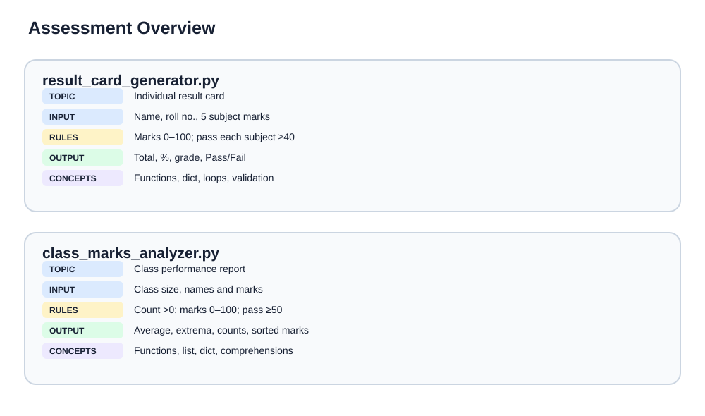
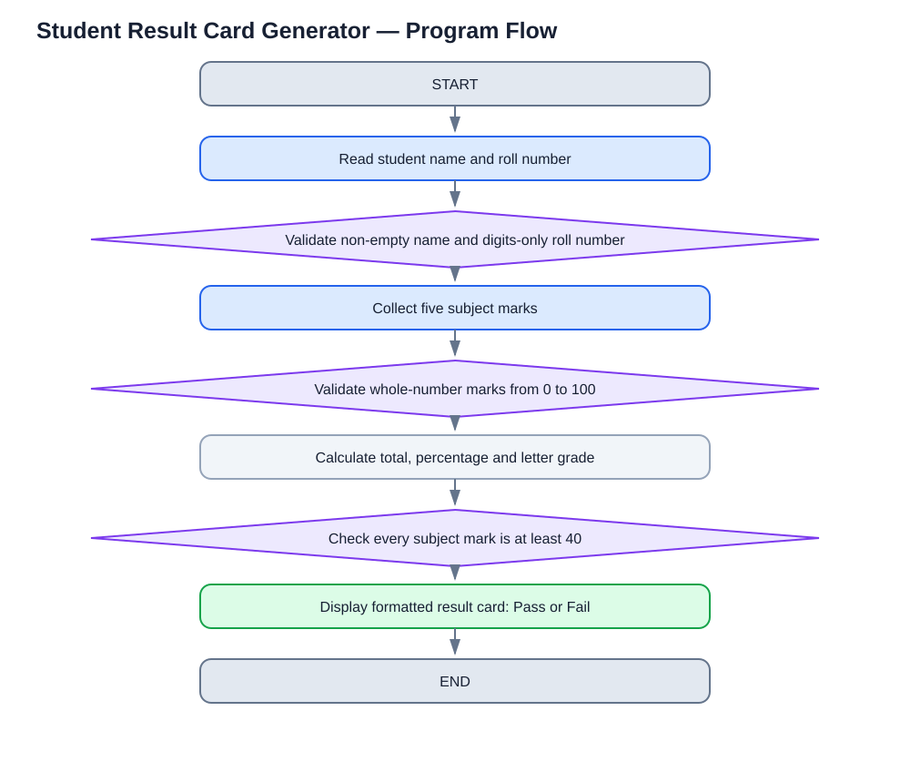
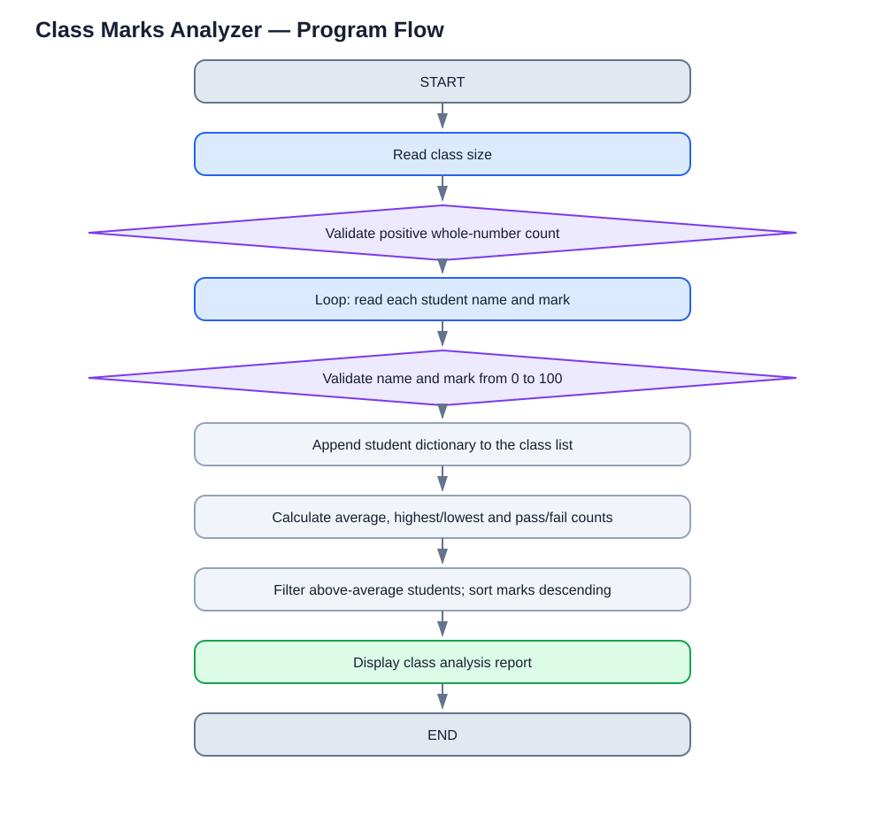
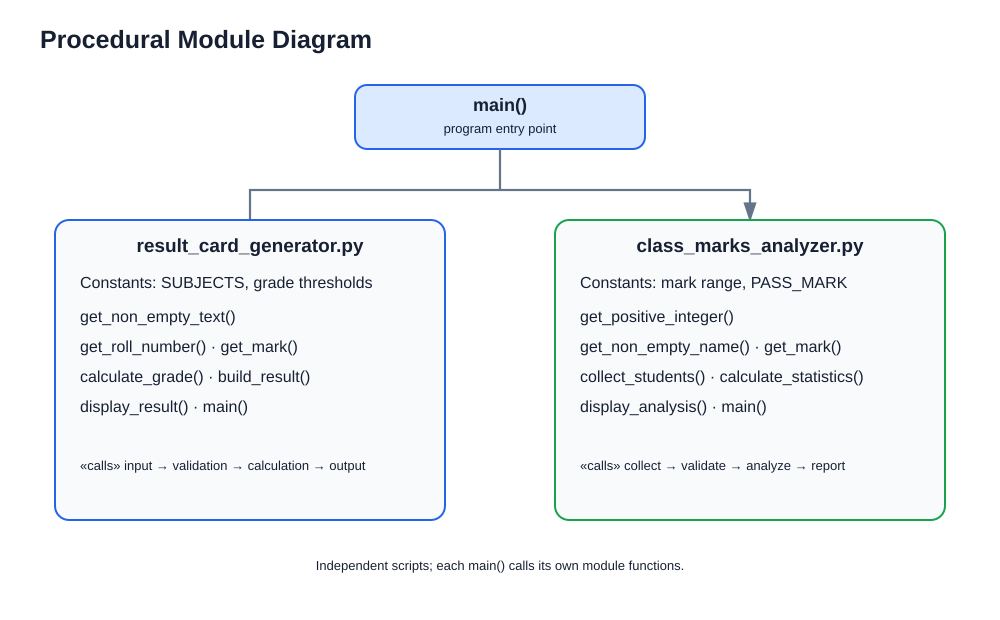

<p align="center"></p>

# 1. Project Overview

Two independent Python programs for student results and class performance.

| Task | File | Topic |
|---|---|---|
| Student Result Card Generator | `result_card_generator.py` | Validated marks, percentage, grade and pass/fail |
| Class Marks Analyzer | `class_marks_analyzer.py` | Average, extrema, pass/fail counts and ranking |



# 2. Folder Structure

```text
python-functions-lists-assessment/
├── README.md
├── result_card_generator.py
├── class_marks_analyzer.py
└── assets/
    ├── banner.svg / banner.png
    ├── overview.svg / overview.png
    ├── result_card_generator_flow.svg / .png
    ├── class_marks_analyzer_flow.svg / .png
    └── uml_diagram.svg / .png
```

# 3. Student Result Card Generator

**Summary:** Collects one student's name, roll number and five subject marks, then prints a formatted result card.

**Rules**
- Marks must be whole numbers from 0 through 100.
- Pass requires every subject mark to be at least 40.
- Grade scale: A ≥80, B ≥70, C ≥60, D ≥50, otherwise F.
- Names cannot be blank; roll number must contain digits only.



**Code Methods Description**

| Method or section | Purpose |
|---|---|
| `get_non_empty_text()` | Validates and title-cases the name |
| `get_roll_number()` | Validates digits-only roll number |
| `get_mark()` | Validates one mark |
| `calculate_grade()` | Maps percentage to a letter grade |
| `build_result()` | Calculates totals, percentage, grade and status |
| `display_result()` | Prints the result card |
| `main()` | Coordinates the program |

**Input Validation**
- Blank names and non-digit roll numbers are rejected.
- Marks use `int()` inside `try/except`; non-integers and values outside 0–100 are rejected.

**Expected Results:** Five subject marks, total out of 500, percentage, letter grade and Pass/Fail status.

# 4. Class Marks Analyzer

**Summary:** Collects a class roster and reports average, highest/lowest marks, pass/fail totals, above-average students and descending marks.

**Rules**
- Class size must be a positive whole number.
- Names cannot be blank; marks must be whole numbers from 0 through 100.
- Passing means 50 or more.
- Above average means strictly greater than the class average.



**Code Methods Description**

| Method or section | Purpose |
|---|---|
| `get_positive_integer()` | Validates class size |
| `get_non_empty_name()` | Validates and title-cases names |
| `get_mark()` | Validates a mark |
| `collect_students()` | Loops and appends student dictionaries |
| `calculate_statistics()` | Calculates statistics and filters/sorts results |
| `display_analysis()` | Prints the report |
| `main()` | Coordinates the program |

**Input Validation**
- Non-integer and non-positive class sizes are rejected.
- Blank names are rejected.
- Non-integer marks and marks outside 0–100 are rejected.

**Expected Results:** Class size, average, highest/lowest students, pass/fail counts, above-average students and sorted marks.

# 5. UML Diagram

A **procedural module diagram** fits because both programs use independent scripts, constants and functions rather than classes; it shows each entry point and its function group.



# 6. Concepts and Techniques Used

- Functions with parameters and return values.
- String methods: `strip()`, `title()` and `isdigit()`.
- Lists, dictionaries and `append()`.
- `len()`, `sum()`, `max()`, `min()` and `sorted()`.
- Loops, conditionals, comprehensions and generator expressions.
- `try/except` input validation and f-string formatting.
- Constants for mark boundaries and pass/grade thresholds.

# 7. How to Run

**Requirements:** Python 3; no external libraries.

```bash
git clone https://github.com/muhammadarslan61029/python-functions-lists-assessment.git
cd python-functions-lists-assessment
python result_card_generator.py
python class_marks_analyzer.py
```

Alternatives: use `python3` instead of `python`, or `py` on Windows.

# 8. Sample Execution

Transcripts below are actual captured program runs.

## 8.1 Result card — successful case

Input:
```text
ali raza
61016
85
92
78
88
81
```
Output:
```text
Student Result Card Generator
Enter student name: Enter roll number: Enter marks for English (0-100): Enter marks for Mathematics (0-100): Enter marks for Science (0-100): Enter marks for Computer (0-100): Enter marks for Urdu (0-100): 
==================================
           STUDENT RESULT CARD
==================================
Student Name : Ali Raza
Roll Number  : 61016
English       :  85/100
Mathematics   :  92/100
Science       :  78/100
Computer      :  88/100
Urdu          :  81/100
----------------------------------
Total Marks  : 424/500
Percentage   : 84.80%
Letter Grade : A
Final Status : Pass
==================================
```

## 8.2 Result card — validation and subject-failure case

Input:
```text
  
Ali Raza
abc
61016
-1
101
x
39
100
0
100
40
```
Output:
```text
Student Result Card Generator
Enter student name: Error: this field cannot be blank.
Enter student name: Enter roll number: Error: roll number must contain digits only.
Enter roll number: Enter marks for English (0-100): Error: marks must be between 0 and 100.
Enter marks for English (0-100): Error: marks must be between 0 and 100.
Enter marks for English (0-100): Error: enter a whole number from 0 to 100.
Enter marks for English (0-100): Enter marks for Mathematics (0-100): Enter marks for Science (0-100): Enter marks for Computer (0-100): Enter marks for Urdu (0-100): 
==================================
           STUDENT RESULT CARD
==================================
Student Name : Ali Raza
Roll Number  : 61016
English       :  39/100
Mathematics   : 100/100
Science       :   0/100
Computer      : 100/100
Urdu          :  40/100
----------------------------------
Total Marks  : 279/500
Percentage   : 55.80%
Letter Grade : D
Final Status : Fail
==================================
```

## 8.3 Class analyzer — successful case

Input:
```text
3
Ali
80
Sara
45
Ahmed
95
```
Output:
```text
Class Marks Analyzer
How many students are in the class? 
Student 1
Enter student name: Enter marks for Ali (0-100): 
Student 2
Enter student name: Enter marks for Sara (0-100): 
Student 3
Enter student name: Enter marks for Ahmed (0-100): 
======================================
          CLASS MARKS ANALYSIS
======================================
Number of students : 3
Class average      : 73.33
Highest marks      : 95
Ahmed: 95
Lowest marks       : 45
Sara: 45
Passing students   : 2
Failing students   : 1
Students above class average:
Ali: 80
Ahmed: 95
Marks from highest to lowest:
[95, 80, 45]
======================================
```

## 8.4 Class analyzer — tied boundary marks and blank name

Input:
```text
2
  
Noor
50
Omar
50
```
Output:
```text
Class Marks Analyzer
How many students are in the class? 
Student 1
Enter student name: Error: student name cannot be blank.
Enter student name: Enter marks for Noor (0-100): 
Student 2
Enter student name: Enter marks for Omar (0-100): 
======================================
          CLASS MARKS ANALYSIS
======================================
Number of students : 2
Class average      : 50.00
Highest marks      : 50
Noor: 50
Omar: 50
Lowest marks       : 50
Noor: 50
Omar: 50
Passing students   : 2
Failing students   : 0
Students above class average:
None
Marks from highest to lowest:
[50, 50]
======================================
```

# 9. Test Cases

## 9.1 Student Result Card Generator

| # | Scenario | Inputs | Expected result |
|---:|---|---|---|
| 1 | Sample | `ali raza`, `61016`, `85, 92, 78, 88, 81` | 424/500, 84.80%, A, Pass |
| 2 | Blank name | Blank then `Ali Raza` | Re-prompt |
| 3 | Invalid roll | `abc` then `61016` | Re-prompt |
| 4 | Invalid marks | `-1`, `101`, `x`, then valid values | Reject each invalid value |
| 5 | Subject failure | One subject 39, others high | Fail |
| 6 | Pass boundary | All marks 40 | Pass |
| 7 | Grade boundaries | Percentages 80, 70, 60, 50, 49 | A, B, C, D, F |

## 9.2 Class Marks Analyzer

| # | Scenario | Inputs | Expected result |
|---:|---|---|---|
| 1 | Sample | Ali 80, Sara 45, Ahmed 95 | Average 73.33; 2 pass, 1 fail |
| 2 | Blank name | Blank then Noor | Re-prompt |
| 3 | Invalid class size | Text, zero or negative | Re-prompt |
| 4 | Invalid marks | Text, -1 or 101 | Reject and re-prompt |
| 5 | Pass boundary | Marks 49 and 50 | One fail, one pass |
| 6 | Equal marks | Two marks of 50 | No student above average |
| 7 | Mark boundaries | Marks 0 and 100 | Both accepted |

# 10. Author

**Muhammad Arslan** · [GitHub repository](https://github.com/muhammadarslan61029/python-functions-lists-assessment)
